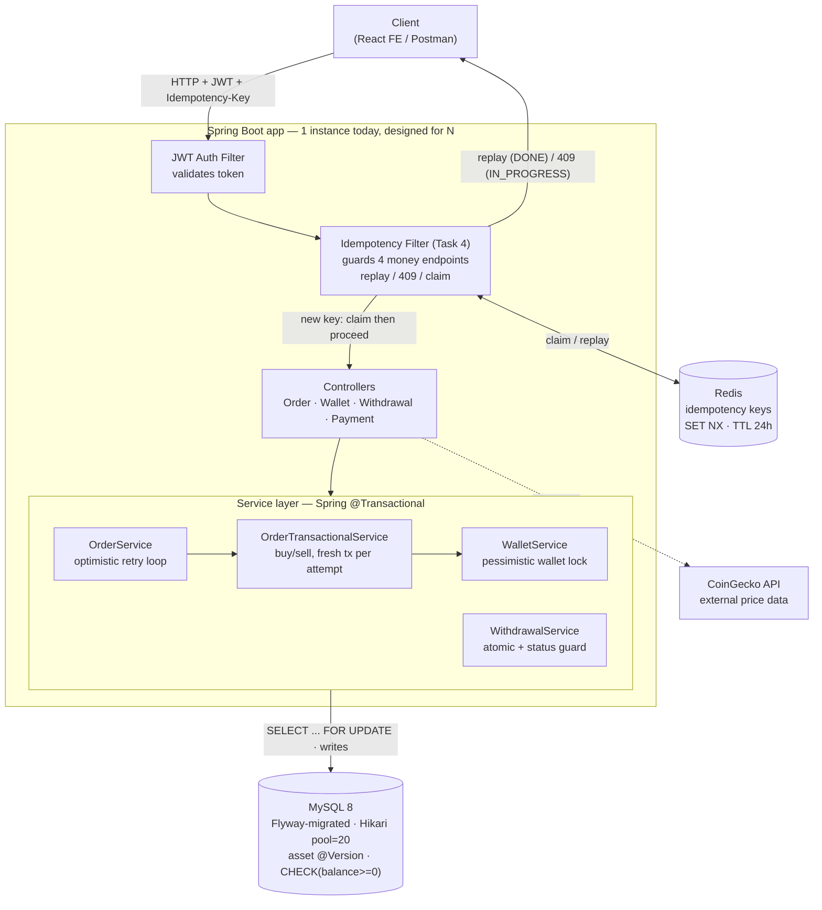
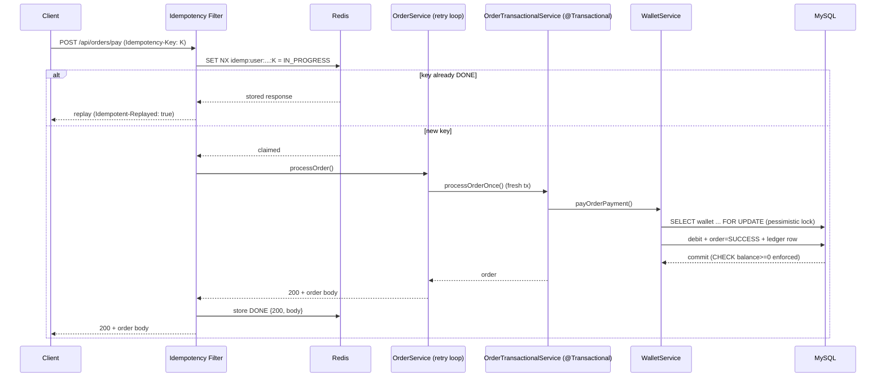
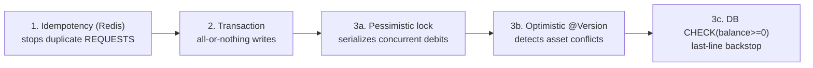

# EazeTrading — Domain & Flows

This document explains the core domain objects and the end-to-end flows for the
main user actions: buying a coin, selling a coin, wallet-to-wallet transfer,
deposits, and withdrawals.

## Core domain objects

- **Coin** — a cryptocurrency (BTC, ETH, …). Market data (price, market cap, etc.)
  is fetched from CoinGecko. `currentPrice` is the live price used for trades.

- **Wallet** — a user's cash balance (`BigDecimal balance`). One per user. This is
  the fiat money used to buy coins and where sale proceeds land.

- **Asset** — how much of a *specific coin* a user currently owns. Fields:
  `quantity` (units held) and `buyPrice` (price when acquired), linked to `coin`
  and `user`. It represents a holding/position. Owning 0.5 BTC means there is an
  `Asset` row saying so.

- **Order** — a record of a trade action (BUY or SELL) at a point in time. Has an
  `orderType` (BUY/SELL), a `price` (total cost/proceeds = coin price × quantity),
  an `orderStatus`, a `timestamp`, and one `OrderItem`.

- **OrderItem** — the detail line of an order: which `coin`, `quantity`,
  `buyPrice`, `sellPrice`. An Order is the transaction; the OrderItem is what was
  traded.

- **WalletTransaction** — the ledger entry. Records every money movement
  (`ADD_MONEY`, `WITHDRAWAL`, `WALLET_TRANSFER`, `BUY_ASSET`, `SELL_ASSET`) for
  history.

**Relationship:** an **Order** (the event) contains an **OrderItem** (what/how
much), moves money in the **Wallet**, and updates the user's **Asset** (their
holding of that coin). Each money move is recorded as a **WalletTransaction**.

---

## Flow 1 — User BUYS a coin

Entry point: `POST /api/orders/pay` → `OrderController.payOrderPayment` with
`{ coinId, quantity, orderType: BUY }`.

1. Resolve user (from JWT) and load the `Coin` via `coinService.findById(coinId)`.
2. `orderService.processOrder(coin, quantity, BUY, user)` → routes to
   `buyAsset(...)`. The whole method is `@Transactional` (all-or-nothing).
3. Validate quantity > 0.
4. Capture buy price = `coin.getCurrentPrice()`.
5. Create the `OrderItem` (coin, quantity, buyPrice, sellPrice = 0) and save it.
6. Create the `Order` — `createOrder` computes `price = currentPrice × quantity`
   and saves it as `PENDING`, type BUY.
7. Charge the wallet — `walletService.payOrderPayment(order, user)`:
   - For BUY it does `balance − order.price`. If that goes negative → throws
     "Insufficient funds" and the whole transaction rolls back (no order, no charge).
8. Mark order `SUCCESS` and save.
9. Update the holding (Asset):
   - If the user has **no existing Asset** for this coin → `createAsset(...)` with
     the bought quantity.
   - If they **already hold** it → `updateAsset(assetId, +quantity)` adds to the
     existing quantity.
10. Ledger → writes a `BUY_ASSET` `WalletTransaction` for `order.price`.
11. Returns the saved order.

**Net effect:** wallet balance drops, the user's Asset for that coin grows (or is
created), an Order + OrderItem record the trade, and a `BUY_ASSET` ledger row is
written.

---

## Flow 2 — User SELLS a coin

Same entry point, `orderType: SELL` → `processOrder` → `sellAsset(...)`
(also `@Transactional`).

1. Validate quantity > 0. Capture `sellPrice = coin.getCurrentPrice()`.
2. Find the user's Asset for that coin (`findAssetByUserIdAndCoinId`). If none →
   throws "Asset not found".
3. Create `OrderItem` (coin, quantity, buyPrice = the asset's original buyPrice,
   sellPrice = current price) and an `Order` (type SELL).
4. Check they hold enough: `assetToSell.quantity >= quantity`. If not →
   "Insufficient quantity to sell" (rolls back).
5. Mark order `SUCCESS`, save.
6. Credit the wallet — `payOrderPayment` for a non-BUY order does
   `balance + order.price`.
7. Reduce the holding — `updateAsset(assetId, −quantity)`.
8. Dust cleanup: if the *remaining* quantity × current price ≤ 1 (worth ≤ 1 unit
   of currency), the Asset is **deleted** — so tiny leftover holdings get removed.
9. Ledger → writes a `SELL_ASSET` `WalletTransaction` for `order.price`.

**Net effect:** wallet balance rises, the user's Asset shrinks (or is deleted if
negligible), Order + OrderItem record the sale, `SELL_ASSET` ledger row written.

> Note: `buyPrice` on the sale's OrderItem is copied from the existing asset, but
> there is no profit/loss calculation stored — it just records both prices. If
> realized P&L is needed later, that is a future addition.

---

## Flow 3 — Wallet-to-wallet transfer

Entry point: `PUT /api/wallet/{walletId}/transfer` →
`WalletController.walletToWalletTransfer`, body carries the `amount`.

1. Sender resolved from JWT; receiver wallet loaded by the path `walletId`.
2. `walletService.walletToWalletTransfer(sender, receiverWallet, amount)`:
   - Loads the sender's wallet.
   - Balance check: if sender balance < amount → throws "Insufficient balance".
   - Debit sender: `senderBalance − amount`, save.
   - Credit receiver: `addBalance(receiverWallet, +amount)`, save.
   - Ledger: generates one `transferId` (UUID) and writes **two**
     `WALLET_TRANSFER` rows — one on the sender's wallet ("Transfer to wallet id X")
     and one on the receiver's ("Transfer from wallet id Y"), both sharing that
     `transferId` so the two sides are correlated.
3. Returns the sender's wallet.

**Net effect:** money moves from one wallet to another; both parties get a matching
ledger entry.

---

## Flow 4 — How money gets INTO a wallet (deposit)

Two-step, because real payment gateways are involved.

**Step A — create payment link:** `POST /api/payment/{method}/amount/{amount}` →
`PaymentController`:
- Creates a `PaymentOrder` (status `PENDING`), then generates a **Razorpay**
  payment link (Stripe currently returns "coming soon"). User pays on the
  gateway's page.

**Step B — confirm deposit:** after paying, the gateway redirects back and the
frontend calls `PUT /api/wallet/deposit?order_id=..&payment_id=..` →
`WalletController.addMoneyToWallet`:
- Loads the `PaymentOrder`. If it is **not PENDING** → 409 "already processed"
  (replay protection).
- `proceedPaymentOrder(order, paymentId)` verifies with Razorpay that the payment
  was **captured**; on success it flips the order to `SUCCESS` and persists it.
- If verified → `walletService.deposit(wallet, amount)` credits the balance **and**
  writes an `ADD_MONEY` ledger row.

**Net effect:** verified external payment increases the wallet balance, recorded as
`ADD_MONEY`.

---

## Flow 5 — How money LEAVES to a bank (withdrawal)

**Request:** `POST /api/withdrawal/{amount}` → `WithdrawalController`:
- Balance check → if insufficient, rejected.
- Creates a `Withdrawal` (status `PENDING`), deducts the amount from the wallet
  immediately (via `addBalance(negate)`), and writes a `WITHDRAWAL` ledger row.

**Admin decision:** `PATCH /api/admin/withdrawal/{id}/proceed/{accept}`
(admin-only):
- **Accept** → status `SUCCESS` (money already deducted; bank payout happens
  externally).
- **Decline** → status `DECLINE` and the amount is **refunded to the withdrawal's
  owner**.

---

## Putting it together (mental model)

```
Deposit (ADD_MONEY)  ─┐
Sell coin (SELL_ASSET)─┤──► Wallet balance ─┬─► Buy coin (BUY_ASSET)  ──► Asset grows
                       │                     ├─► Transfer out          ──► other Wallet
                       │                     └─► Withdrawal            ──► bank (admin approves)
                       │
        Every one of these writes a WalletTransaction (the ledger/history).
```

- **Wallet** = your cash. **Asset** = your coin holdings. **Order/OrderItem** = the
  trade records. **WalletTransaction** = the history of every money movement.
- Buying converts wallet cash → an Asset. Selling converts an Asset → wallet cash.
  Deposits/transfers/withdrawals move cash in and out.


---

# System Architecture (through Task 4 — hardening in progress)

EazeTrading is being hardened from a raw starter into a production-grade,
horizontally-scalable system. This section captures the architecture as of
**Task 4 (Redis-backed idempotency)**. Tasks 1–4 are complete; Tasks 5–14
(caching, resilience, RabbitMQ, outbox, distributed locks, observability,
dockerization, deploy) are upcoming.

## High-level request flow



## Buy path — sequence (idempotency + locking together)



## Layered safety model (defense in depth)



## What each task added

| Task | Theme | Key mechanisms |
|------|-------|----------------|
| 1 | Foundation | Flyway migrations (schema-as-code), `ddl-auto=validate`, secrets externalized to env |
| 2 | Transaction boundaries | Spring `@Transactional(rollbackFor=Exception.class)` on proxied entry points; self-invocation bug fixed; atomic withdrawal; ownership + status guards |
| 3 | Concurrency control | Pessimistic `SELECT…FOR UPDATE` on the hot wallet row; optimistic `@Version` + bounded retry on assets; `CHECK(balance>=0)` backstop; deadlock-safe transfers (lock by ascending id); proven by a concurrent-buy integration test |
| 4 | Idempotency | Redis client-generated `Idempotency-Key`; atomic `SET NX` claim; replay on retry; 409 on in-flight duplicate; cross-cutting filter; lenient/opt-in |

## Infrastructure

| Component | Role | Status |
|-----------|------|--------|
| MySQL 8 | System of record; locks + CHECK constraint; Flyway-migrated | active |
| Redis (eaze-redis, 7-alpine) | Idempotency store (later: cache, locks) | active |
| CoinGecko | External price data | not yet cached / resilient (Tasks 5–6) |
| RabbitMQ | Async work (emails, outbox, withdrawals) | planned (Task 7+) |

## Performance baseline (Task 3→4)

Local "one server" (18 vCPU / 16 GB, WSL2), k6 mixed 70/30 read/write, ramp to 200 VUs:

| Hikari pool | Throughput | p95 (overall) | Note |
|-------------|-----------|---------------|------|
| 10 (default) | ~40 req/s | 24.6 s | starved |
| 20 (chosen) | ~86 req/s | 272 ms | sweet spot |
| 50 | ~98 req/s | 443 ms | diminishing returns / worse p95 |

Bottleneck: write-path wallet row-lock serialization, not connections. Re-run
`loadtest/baseline.js` after each task to quantify improvement.
